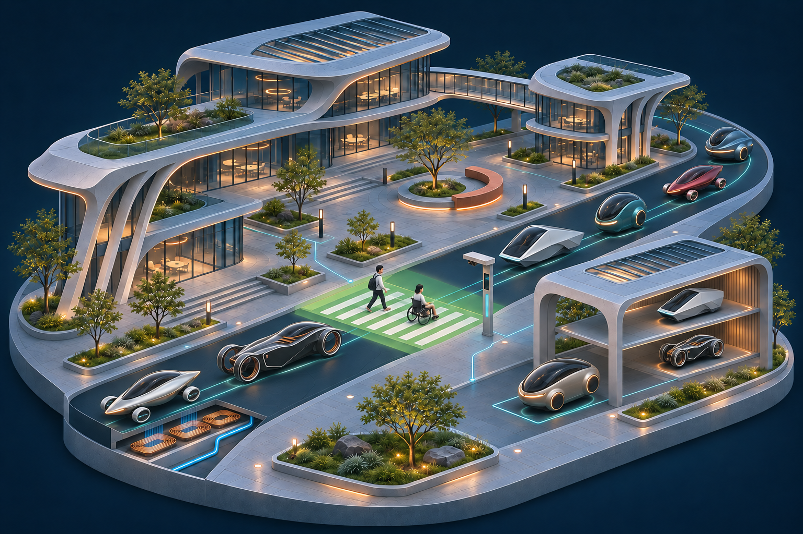
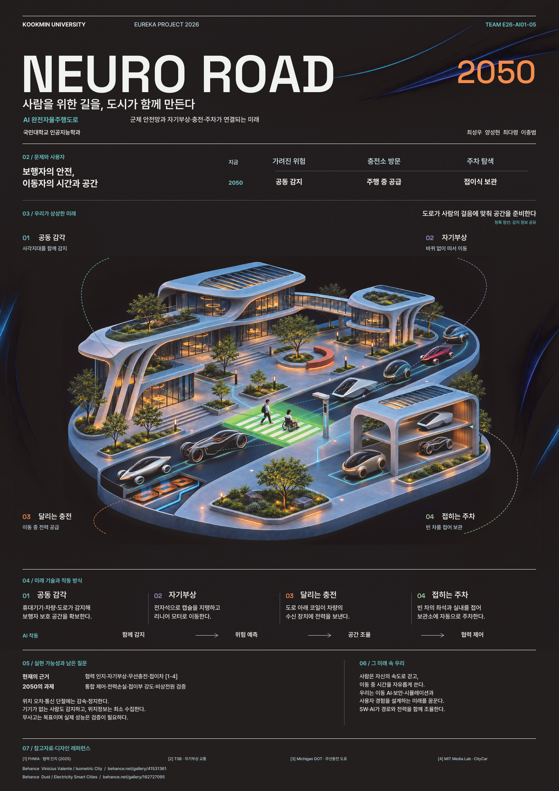

# NEURO ROAD 2050

### 사람을 위한 길을, 도시가 함께 만든다

**AI 완전자율주행도로 · 국민대학교 인공지능학과 · E26-AI01-05**

2050년, 차량과 도로가 주변의 위험을 함께 감지하고 사람의 걸음에 맞춰 이동 공간을 준비하는 도시를 상상합니다. **군체 안전망·자기부상·주행 중 무선충전·접이식 주차**를 하나의 전용 도로 시스템으로 연결한 미래 기획입니다.

[미래 서비스 기획 →](week07.md) · [포스터와 편집 원본 →](poster/README.md) · [발표와 미래 속 우리 →](presentation.md)

> **현재 단계: 미래 서비스 기획과 포스터 3차 초안** · 2026.11.02 
> 2050년의 가상 장면입니다. 개별 기술의 현재 사례를 바탕으로 통합 시스템을 구상했으며, 실제 도로 구현이나 안전 성능 검증을 마친 프로젝트는 아닙니다.

## 01 / 우리가 바꾸고 싶은 이동

| 지금의 불편 | 2050년에 기대하는 변화 |
| --- | --- |
| 차량 한 대의 시야만으로 놓칠 수 있는 위험 | 차량·도로·휴대기기가 감지 정보를 공유하고 보행자 공간을 미리 확보 |
| 충전 장소를 찾아 이동·대기 | 전용 도로의 충전 구간에서 이동 중 전력 공급 |
| 주차할 곳을 찾고 넓은 공간을 점유 | 사람이 내린 차량이 차체를 줄여 자동 보관 |

### 네 가지 핵심 기능

| 번호 | 기능 | 우리가 상상한 작동 방식 |
| --- | --- | --- |
| **01** | **공동 감각** | 휴대기기·차량·도로 센서의 정보를 합쳐 가려진 위험을 예측하고, 주변 차량이 함께 속도와 간격을 조절 |
| **02** | **자기부상** | 전용 도로의 전자석과 리니어 모터를 통해 바퀴 없이 차량을 지탱하고 이동 |
| **03** | **달리는 충전** | 도로 아래 코일과 차량 수신 장치를 연결해 주행 중 전력을 공급 |
| **04** | **접히는 주차** | 탑승자가 내린 뒤 좌석·실내와 가변 차체를 접어 보관 공간을 줄이고 자동 주차 |

**함께 감지 → 위험 예측 → 공간 조율 → 협력 제어**

차량은 리프형·그랜드투어러·쐐기형·포드 등 서로 다른 모습으로 디자인했습니다. 형태가 달라도 같은 도로의 통신·부상·충전 규격을 이용한다는 미래 가정입니다. 휴대기기가 없는 보행자도 도로와 차량 센서로 보호하며, 위치 오차나 통신 단절에는 감속·정지하도록 구상합니다. **무사고는 지향하는 목표이며 보장된 성능 수치가 아닙니다.**

---

## 02 / 한 장으로 보는 미래

  

  A0 세로형 · 841 × 1,189mm · 1페이지 · CMYK · 포스터 3차 초안

[**포스터 PDF 보기 →**](poster/NEURO_ROAD_2050_A0.pdf) · [편집용 SVG](poster/NEURO_ROAD_2050_Editable.svg) · [원본·글꼴 묶음](poster/NEURO_ROAD_2050_Editable_Package.zip)

최종 발표는 이 포스터 한 장을 중심으로 준비합니다. 삽화는 확대 처리한 초안으로, 최종 A0 출력 전 원본 해상도 보강이 필요합니다. 파일 구성과 출력 조건은 [포스터 안내](poster/README.md)에 정리했습니다.

## 03 / 프로젝트 활동 기록

| 수업 활동 | 주제와 기록 | 바로 보기 |
| --- | --- | --- |
| 과거에 사람들이 상상한 미래 | 전기자동차에서 자율주행으로 이어진 상상과 기술 | 👉 [week03 활동 보기](week03.md) |
| 그들이 만들어가는 세상 | **Re:Stage** — 국민대생의 팀 발표 준비를 돕는 AI 서비스 소주제 | 👉 [week05 활동 보기](week05.md) |
| 우리가 상상한 미래 | **NEURO ROAD 2050** — 완전자율주행도로의 미래 장면·캔버스·기술·검증 질문 | 👉 [week07 활동 보기](week07.md) |
| 우리가 그리는 미래 그리고 나 | 포스터 발표 흐름, 미래의 생활과 팀원들의 관심사 | 👉 [발표 준비 보기](presentation.md) |

전기차·자율주행을 살펴본 활동에서 출발해, 최종 발표에서는 **차량 한 대를 넘어 도로 전체가 협력하는 미래**를 탐구합니다. Re:Stage는 대학생활의 불편을 다룬 별도 소주제입니다. [Re:Stage 2045 확장 기획](docs/activities/restage-2045.md)도 활동 기록으로 보관했습니다.

---

## 04 / 팀원 소개

> **오늘을 학습해 내일을 만든다.**

같은 학과에서 공부하는 네 명이 서로 다른 관심사를 바탕으로 미래를 그립니다. 아래 내용은 팀원들의 관심사이며, 프로젝트의 실제 역할 분담과는 구분합니다.

| **이름** | **전공** | **관심사 / 희망 진로** |
| --- | --- | --- |
| **최성우** | 인공지능학과 | 창업, 개발자, 해외 디지털 노마드 |
| **양성현** | 인공지능학과 | 취업, 인공지능 보안, 대학원 진학 |
| **최다령** | 인공지능학과   | 영어 공부, 일과 여가의 균형 |
| **이충범** | 인공지능학과 | 인디게임 개발, AI 도구를 활용한 게임 제작 |

### 팀원들이 꿈꾸는 미래

- **최성우**
  - 개발자로 해외에 나가 디지털 노마드로 살아가는 것
  - 창업에 관심이 있음
  - 가장 듣고 싶은 교과목: **AIX**

- **양성현**
  - 취업을 목표로 하고 있음
  - 대학원 진학을 많이 하는지 궁금함
  - 가장 듣고 싶은 교과목: **인공지능 보안**

- **최다령**
  - 하고 싶은 일을 하면서 여가생활도 즐기는 삶을 희망
  - 영어 공부에 관심이 있음
  - 졸업 후 학생들이 어떤 진로를 많이 선택하는지 궁금함
  - 가장 듣고 싶은 교과목: **스키 교양**

- **이충범**
  - 인디게임 개발자를 희망
  - 최근 GPT, Astra, Higgsfield 등의 AI 도구와 플러그인을 활용하여
    간단한 3D 데모 게임을 제작하는 것에 관심이 있음
  - 석사 대학원 과정에서 학부에서 배운 내용을 어느 정도까지
    확장하여 배우는지 궁금함
  - 가장 듣고 싶은 교과목: **게임소프트웨어**

### 팀 소개

우리 팀은 같은 학과에서 공부하고 있지만 각자가 꿈꾸는 미래는 다양합니다.

해외에서 활동하는 개발자와 디지털 노마드, 취업, 워라밸을 중요하게
생각하는 삶, 인디게임 개발자 등 서로 다른 목표를 가지고 있습니다.

관심 분야 역시 창업, 인공지능 보안, 영어 공부, AI 기반 게임 개발 등
서로 다르지만, 각자가 자신에게 맞는 분야를 찾고 전문성을 키워
미래의 진로로 연결하고 싶다는 공통점을 가지고 있습니다.

---

## 05 / 공통된 관심사: AI 시대의 전문성과 미래 진로

에이전틱 AI의 발전으로 인간이 수행하던 많은 기술과 업무가
빠르게 대체되고 있습니다.

우리 팀은 이러한 시대일수록 AI가 쉽게 대체하기 어려운
**자신만의 도메인 전문성**이 중요하다고 생각했습니다.

특히 교과서나 데이터만으로 배우기 어려운 현장의 흐름과 맥락을 이해하고,
직접 경험을 쌓으며 직관적인 판단력을 키우는 것이 앞으로 중요한
경쟁력이 될 것이라고 생각합니다.

팀원들의 관심 분야와 희망 진로는 서로 다르지만,

> **자신이 원하는 분야를 찾고, 자신만의 전문성을 키워  
> 미래의 진로로 연결하고 싶다**

는 점에서는 공통된 생각을 가지고 있습니다.

---

## 06 / 한 학기 동안의 활동

- 기관/부서 인터뷰 ✔️  

- 현장 탐방 ✔️  

- 멘토링 ✔️  
  - 지도 교수님 만나기
  - 대학원 방문 및 선배 만나기

- 프로젝트 기획 및 포스터 제작
  - [NEURO ROAD 2050 미래 기획](week07.md)
  - [최종 발표용 포스터 초안](poster/README.md)
  - [발표와 미래 속 우리](presentation.md)

- 각오와 소감 나누기 ✔️  

## 07 / 인상 깊은 활동

### 💬 팀원들과 서로의 미래에 대해 이야기하기

가장 인상 깊었던 활동은 팀원들이 각자가 원하는 미래와
관심 분야에 대해 이야기했던 활동입니다.

같은 학과에서 공부하고 있음에도 불구하고
개발자, 창업, 취업, 영어, 게임 개발 등
각자가 생각하고 있는 대학생활과 진로의 방향이 매우 다양했습니다.

특히 AI 기술이 빠르게 발전하는 상황에서
단순히 기술을 배우는 것만으로는 충분하지 않으며,
자신이 좋아하고 잘할 수 있는 분야를 찾아
그 분야에서 직접 경험을 쌓는 것이 중요하다는 점을 생각하게 되었습니다.

서로 다른 목표를 가진 팀원들과 이야기하면서
내가 미처 생각하지 못했던 새로운 진로와 대학생활의 방향도
접할 수 있었습니다.

---

## 08 / 특별히 알아보고 싶은 것

우리 팀원들의 의견을 바탕으로 앞으로 다음과 같은 내용을
조금 더 알아보고 싶습니다.

- 대학원 진학을 선택하는 학생들의 비율과 주요 진로
- 석사 과정에서 학부 과정의 내용을 어느 정도까지 확장하여 배우는지
- 졸업 후 학생들이 주로 선택하는 진로
- AI 및 게임소프트웨어 관련 교과목
- 인공지능 보안 분야
- 창업 및 개발자로서 해외에서 활동할 수 있는 방법
- AI 시대에 경쟁력을 가질 수 있는 전문성은 무엇인지
- 학부 과정에서 자신만의 도메인 전문성을 키우는 방법

---

## 09 / 활동을 마친 소감

개인 소감은 팀원이 직접 작성할 공간입니다.

### 🔗 최성우

> "개인이 작성해 주세요."

### 🔗 양성현

> "개인이 작성해 주세요."

### 🔗 최다령

> "개인이 작성해 주세요."

### 🔗 이충범

> "개인이 작성해 주세요."

---

## 📸 팀 활동 사진

팀 활동 사진은 추후 이곳에 추가합니다.

---

## 🚀 우리가 앞으로 그리고 싶은 미래

사람은 자신의 속도로 걷고, 이동 중 시간을 자유롭게 씁니다. 도시는 사람을 감지하고 기다리며, 차량의 경로와 전력을 함께 조율합니다.

이 미래에는 이동 AI, 보안, 시뮬레이션과 사용자 경험을 설계하는 일이 필요합니다. 각자의 관심사를 어떤 전문성으로 발전시킬지는 [미래 속 우리](presentation.md)에서 함께 탐색합니다.

---

### Team E26-AI01-05

**NEURO ROAD 2050 — 사람을 위한 길을, 도시가 함께 만든다.**
