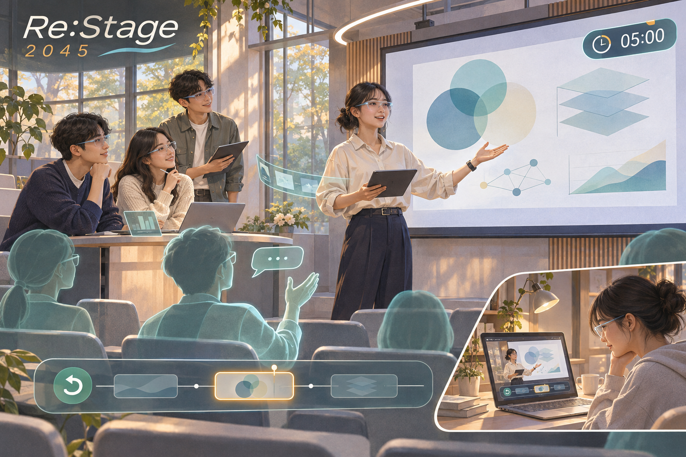

# 활동 기록: Re:Stage 2045 확장 기획

[← 팀 홈](../../README.md) · [대학생활 문제 정의](../../week05.md) · [최종 발표 주제](../../week07.md)

> ‘그들이 만들어가는 세상’에서 탐색한 Re:Stage 소주제의 확장 기록이다. 최종 발표는 **NEURO ROAD 2050 — AI 완전자율주행도로**로 진행하며, 아래 내용은 이전 기획을 보존한 것이다.

## Re:Stage 2045

> **발표 당일이, 우리 팀의 첫 무대가 되지 않도록.** 
> 국민대생이 함께 말하고, 질문받고, 다시 연습하는 미래의 발표 연습실

*AI로 제작한 미래 서비스 콘셉트 이미지. 실제 국민대 시설이나 팀원 사진이 아니다.*

팀 E26-AI01-05 · 작성 2026.11.02 · 수업 연결: Week 03 「우리가 그려보는 미래 I」

**기획 초안:** 앞선 [대학생활 문제 정의](../../week05.md)를 2045년의 대학으로 확장했다. 미래 장면은 가상 시나리오이며, 효과 검증과 팀 역할 확정은 아직 수행하지 않았다.

---

## 미션 1. 미래 장면과 문제 선택

### 왜 발표 연습인가

AI가 발표 자료를 빠르게 만드는 시대에도, **그 내용을 팀이 자기 말로 설명하고 질문에 답하는 일**은 남는다. 각자 완성한 슬라이드가 한 팀의 발표로 이어지는지는 직접 말해 봐야 확인할 수 있다.

기획의 핵심 질문은 다음과 같다.

> **장소가 달라도 한 팀처럼 연습하고, 잘못 설명한 순간으로 돌아가 다시 말할 수 있다면?**

### 미래 방향 후보

| 후보 | 기대하는 사용자 가치 | 기획 판단 |
| --- | --- | --- |
| A. 모든 발표를 대신하는 AI 아바타 | 준비 부담 감소 | 학생이 직접 설명하는 경험이 줄어들어 제외 |
| B. 개인 맞춤 스피치 코치 | 혼자 반복 연습 | 이미 존재하는 서비스와 겹침. 개인 연습 단계로 활용 가능 |
| **C. 팀이 공유하는 가상 리허설 캠퍼스** | 발표자 전환·질의응답·재연습을 한 흐름으로 경험 | **이 초안의 중심 방향** |

‘가상 청중이 있다’는 기능만으로 차별화하지 않는다. **한국어 팀 발표의 흐름, 수업별 기준, 근거 확인, 부분 재연습**을 함께 설계한다.

### 선택한 미래 장면: 2045년 국민대생의 하루

다음은 실제 조사 참여자가 아닌 **가상의 사용자 장면**이다.

| 단계 | 장면 | 사용자가 얻는 변화 |
| --- | --- | --- |
| **발표 전날 저녁** | 1학년 네 명이 교내 연습 공간과 각자의 방에서 같은 리허설 세션에 접속한다. 발표 조건은 5분, 이후 질의응답이다. | 같은 공간에 모이지 않아도 전체 흐름을 맞춰 볼 수 있다. 모두 말할 수 있는 실제 장소는 필요하다. |
| **첫 리허설** | 두 번째 발표자가 앞부분의 설명을 다시 반복한다. 학생들이 타임라인에 이 구간을 표시한다. | 파일로 읽을 때 놓친 중복과 연결 문제를 발견한다. |
| **질의응답** | 가상 청중이 “그 수치의 출처는 어디인가요?”라고 묻는다. 연결된 자료에 근거가 없어 ‘확인 필요’로 남는다. | 유창한 답변보다 검증 가능한 설명이 필요한 지점을 찾는다. |
| **다시 연습** | 팀은 전환 구간을 고치고, 청중석 시점에서 녹음을 들어 본 뒤 해당 40초를 다시 말한다. | 처음부터 반복하지 않고 문제 구간을 수정한다. |
| **다음 날** | 학생들은 각자 선택한 수정 메모를 가지고 실제 수업에 들어간다. | 연습에서 발견한 문제를 반영한다. 실제 평가 향상 여부는 따로 확인해야 한다. |

## 미션 2. 미래 서비스 캔버스와 시각화

### 캔버스 7칸

| 항목 | Re:Stage의 설계 |
| --- | --- |
| **01 사용자** | 한국어 팀 발표를 하는 국민대 학생 3~5명. 초기 적용은 1학년 수업의 짧은 발표로 좁힘 |
| **02 상황** | 자료를 완성한 뒤, 다른 장소의 팀원들과 전체 발표와 질문 응답을 맞춰 봐야 할 때 |
| **03 현재의 불편** | 개인 대본 확인만으로는 팀 전체의 연결·시간·근거를 점검하기 어려움. 청중과 장소를 함께 구하는 부담도 있음 |
| **04 미래의 변화** | 학교가 제공하는 가상 연습 공간에 노트북이나 가벼운 XR 기기로 참여하고, 허가된 강의실 환경과 수업 기준을 불러와 연습함 |
| **05 핵심 경험** | 청중의 자리에서 내 설명을 다시 듣고, 막힌 구간으로 돌아가 팀원과 함께 다시 말하는 경험 |
| **06 필요한 기술** | 한국어 음성 인식, 화자 구분, 슬라이드와 발화의 시간 연결, 근거 자료 검색, 다인 공간 동기화, 교실의 음향·시야 재현 |
| **07 남은 위험** | AI 질문의 오류, 말투·언어에 따른 편향, 녹음 유출, 팀원 감시, 기기 접근성 격차, 실제 청중과 다른 반응 |

## 04. 핵심 기능은 세 가지

### 1. 같은 무대에서 함께 연습하기

발표 순서와 제한 시간을 정하고 가상 강의실에 모인다. 학생이 직접 발표하며, 전환 시점을 표시한다. 노트북으로도 기본 기능을 사용할 수 있게 해 XR 기기를 필수로 만들지 않는다.

2045년에는 허가된 교실 모델을 바탕으로 뒤쪽 좌석의 화면 크기나 음성 전달을 체험하는 장면을 구상한다. **정확한 음향·시야 재현과 기기 보급은 미래 가정**이며 현재 확보한 성능이 아니다.

### 2. 자료를 읽은 청중에게 질문받기

‘처음 듣는 학생’, ‘근거를 확인하는 청중’ 등 일반적인 역할을 고른다. AI는 팀이 제공한 자료와 발표 내용을 토대로 질문하고, 어떤 슬라이드·문장에서 질문이 나왔는지 연결한다.

실제 교수의 얼굴·목소리를 복제하거나 질문을 예언하지 않는다. 자료 연결도 틀릴 수 있으므로 사용자가 원문을 직접 확인할 수 있게 한다. AI 청중의 반응은 **연습을 위한 시뮬레이션**이지 실제 학생들의 이해도 측정값이 아니다.

### 3. 그 순간으로 돌아가 다시 말하기

동의받아 기록한 발표를 구간별로 확인한다. 학생이 선택한 중복 설명·긴 공백·근거 확인 구간에서 재연습을 시작한다. 처음 녹음과 수정 녹음을 비교하고, 채택할 수정은 팀이 결정한다.

개인별 서열이나 기여도 점수 대신 **‘우리가 무엇을 바꿨는가’**를 남긴다.

### 서비스가 작동하는 흐름

| 입력 | 처리 | 학생이 받는 결과 |
| --- | --- | --- |
| 직접 올린 발표 자료, 수업 기준, 발표 순서 | 자료 읽기와 시간 설정 | 리허설 준비 화면 |
| 동의한 음성·슬라이드 전환 기록 | 발화와 자료를 시간순으로 연결 | 팀 발표 타임라인 |
| 발표 내용과 참고 자료 | 자료 기반 질문 생성, 연결 근거 표시 | 질문 카드·원문 확인 링크 |
| 팀이 고른 수정 지점 | 해당 구간 재생과 재녹음 | 전후 기록·팀 수정 메모 |

학교 계정 비밀번호를 수집하거나 eCampus를 자동으로 읽는 기능은 초기 범위에 넣지 않는다. 학생이 이용 권한이 있는 자료를 직접 등록하는 방식부터 검토한다.

## 05. 현재 가능한 것과 미래에 필요한 것

자료 확인일: **2026.11.02**. 아래는 공식 기관·서비스 설명을 확인한 결과이며, 해당 도구가 우리 기획의 학습 효과를 보장한다는 뜻은 아니다.

| 비교 대상 | 확인한 사실 | 이 기획에서 얻는 시사점 |
| --- | --- | --- |
| [국민대 K*STUDIO 안내](https://chem.kookmin.ac.kr/chem/community/notice001.do?articleNo=5938532&mode=view) | 2026.07.01 안내에 학생 이용 대상, 촬영 장비, 공간 예약 경로가 기재됨 | 기존 시설과 연결할 수 있는지 검토. 현재 운영 조건·예약 현황·협력 여부는 별도 확인 |
| [Microsoft Speaker Coach](https://support.microsoft.com/en-us/powerpoint/rehearse-your-slide-show-with-speaker-coach) | 말하기 속도 등의 리허설 피드백 제공. 공식 설명은 영어 및 한 명의 발표자 중심 사용을 안내 | 한국어 팀 발표의 전환과 근거 확인에 집중할 이유. 한국어 미지원이라는 설명은 확인일의 문서 기준 |
| [VirtualSpeech 발표 연습](https://virtualspeech.com/practice/presentation-skills) | 웹·VR 발표 환경, 발표 내용 기반 AI 질문, 연습 피드백을 안내 | AI 청중·VR 리허설은 이미 존재. 새 기술을 발명했다고 주장할 수 없음 |
| [VirtualSpeech 다인 연습](https://support.virtualspeech.com/Main%20Menu%20and%20Content%20Navigation-f94de67a-f502-4da2-834f-8cd8f1b8103a) | 여러 사람이 함께 하는 연습과 혼합현실 기능을 안내 | ‘여러 명이 접속한다’만으로도 차별화가 부족. 수업 기준과 팀 수정 과정의 실제 효용을 검증해야 함 |

### 2045년을 상상하는 이유

현재도 웹에서 녹음·화면 공유·질문 생성으로 작은 실험을 시작할 수 있다. 2045년의 장면은 이 기능을 처음 발명하는 미래가 아니라, **수업마다 가상 연습 공간을 사용할 수 있는 대학의 학습 환경**을 상상한 것이다.

| 지금 시작할 작은 실험 | 2045년에 기대하는 환경 | 아직 확인하지 못한 조건 |
| --- | --- | --- |
| 웹 회의와 수동 구간 표시 | 교실의 시야·음향까지 공유하는 공간 | 현실과 충분히 비슷한 재현, 낮은 지연 |
| 학생이 자료·발표 기준 직접 등록 | 허가된 수업 기준·교실 모델 제공 | 학교와의 연계 및 이용 허가 |
| 질문 생성 후 사람이 근거 확인 | 한국어 다인 발화를 안정적으로 연결 | 인식 오류와 근거 연결 오류의 지속적 검증 |
| 2~3개 팀 대상 탐색 실험 | 기기 유무와 관계없이 이용 가능한 교내 서비스 | 대여 기기·운영 인력·비용 부담의 해결 |

## 06. 검증 질문과 운영 설계

| 영역 | 핵심 질문 | 검증 방법 또는 설계 방향 |
| --- | --- | --- |
| **사용자 가치** | AI 질문이 추가될 때 실제로 팀의 설명이 바뀌는가? | 기본 녹음 재생과 질문 포함 연습을 비교. 실제 수정된 구간 기록 |
| **기술·데이터** | 한국어 전공 용어와 발표자 전환을 제대로 연결하는가? | 동의받은 짧은 표본을 사람이 확인하고 인식·연결 오류 기록 |
| **운영·비용** | 학교가 유지할 수 있는 수준인가? | 세션 길이별 처리 시간·추론 비용 측정. 동시 접속·저장·지원 인력 비용을 별도 산정 |
| **개인정보** | 실수한 녹음이 원치 않게 공유되지 않는가? | 참여자별 녹음 동의, 세션별 공유 범위, 보관 기간 선택과 삭제 기능 점검 |
| **공정성·접근성** | 억양이나 기기 유무가 불이익으로 이어지는가? | 말투를 성격·능력 점수로 환산하지 않음. 자막·텍스트 질문·노트북 모드 제공 방향 검토 |
| **학습** | AI 답변을 외우는 데 그치지 않는가? | 완성 답안을 자동 제공하기보다 출처 확인과 본인 설명을 요청 |

초기 이용자는 학생 팀, 운영 협력 후보는 학습지원 부서다. **학교와의 협약이나 도입 승인을 받은 상태는 아니다.** 가격·성능·만족도 수치는 측정 전이므로 제시하지 않는다. 유료 이용량 제한이나 학교 단위 지원 여부도 수요를 확인한 뒤 비교한다.

### 멘토에게 가져갈 질문

1. **배경:** 자료 제작 도구는 많지만 팀 전체 연습의 어려움은 아직 확인 전이다. **가설:** 팀의 문제 구간을 보여 주면 수정 행동이 늘어난다. **질문:** 단순 반복 연습의 효과와 서비스의 효과를 어떻게 구분하면 좋을까?
2. **배경:** 자료에 연결된 AI 질문도 틀릴 수 있다. **가설:** 원문 링크와 ‘확인 필요’ 표시가 검토를 돕는다. **질문:** 학생용 시제품에서 어느 오류를 먼저 막아야 할까?
3. **배경:** 음성과 발표 자료를 기록한다. **가설:** 저장 범위와 삭제를 학생이 통제하면 부담을 줄일 수 있다. **질문:** 교내 운영을 검토할 때 필요한 동의·보관 절차와 담당 부서는 무엇일까?

멘토링을 진행한 뒤 실제 답변과 **수정할 세 가지·다음 행동 한 가지**를 기록한다. 현재는 질문만 준비한 상태다.

## 07. 팀의 관심사와 연결하기

다음은 기존 팀 소개를 바탕으로 한 **역할 제안**이다. 실제 분담은 팀원과 협의해 확정한다.

| 팀원 | 관심사와 연결한 역할 제안 | 만들어 볼 결과물 |
| --- | --- | --- |
| 최성우 | 창업·개발 관점의 서비스 기획, 논의 진행 | 사용자 문제와 운영 방식, 시제품 범위 |
| 양성현 | AI 보안 관점의 데이터·위험 검토 | 녹음 동의·공유·삭제 흐름, 근거 연결 오류 점검 |
| 최다령 | 사용자 관찰과 질문·피드백 문구 검토 | 인터뷰 기록, 한국어·영어 이용 시 어려움 비교 |
| 이충범 | 게임·AI 도구 관점의 공간 시각화 | 가상 연습실 장면, 청중 역할과 재연습 동선 |

## 08. 90초 소개 대본 초안

> 저희가 제안하는 Re:Stage는 국민대생을 위한 팀 발표 연습실입니다.
>
> 자료를 다 만들었다고 발표 준비가 끝난 것은 아닙니다. 각자의 설명이 이어지는지, 시간을 넘기지 않는지, 질문에 근거를 들어 답할 수 있는지는 함께 말해 봐야 알 수 있습니다. 저희는 이 과정이 실제로 어디서 어려운지 학생 인터뷰로 확인하려고 합니다.
>
> 2045년의 Re:Stage에서는 다른 장소의 팀원도 같은 가상 강의실에서 연습합니다. 자료를 읽은 AI 청중에게 질문을 받고, 근거가 부족하거나 설명이 겹친 구간으로 돌아가 다시 말합니다. 노트북으로도 참여할 수 있습니다.
>
> AI 발표 코치와 다인 VR 연습은 이미 존재합니다. 저희의 초점은 한국어 수업의 기준에 맞춰, 팀이 무엇을 수정했는지 남기는 과정입니다. 실제 교수의 평가를 예측하거나 팀원을 점수로 줄 세우지 않습니다.
>
> 먼저 웹 화면과 짧은 리허설로 시작해 보겠습니다. 저희가 확인하려는 것은 AI의 점수가 아니라, 연습 이후 우리 팀의 설명이 실제로 나아졌는가입니다.

## 09. AI 활용과 다음 행동

| 구분 | 기록 |
| --- | --- |
| **사용자가 제시한 방향** | 국민대 대학생활의 불편을 다루고, 공개된 타 팀의 주요 주제와 다르게 구성 |
| **AI의 지원** | 주제 제안, 공식 출처 조사, 서비스 캔버스·비교표·시나리오·문서 작성 |
| **이미지 제작** | OpenAI 이미지 생성 도구로 미래 장면 제작. [생성 프롬프트 원문](../../assets/restage-scene.prompt.txt) 보관 |
| **검토 기준** | 현재 기능과 미래 가정 구분, 기존 시설·제품 인정, 허구의 조사 결과와 팀원 발언 배제 |
| **사람이 이어서 할 일** | 실제 경험 수집, 세부 기능 검토, 역할 확정, 초안 수정 |

**다음 행동:** 학생 인터뷰로 문제를 확인한 뒤, 5분짜리 팀 발표 한 편에서 ‘전환 구간 표시 → 자료 기반 질문 → 구간 재연습’을 수동으로 먼저 시험한다. 가상 공간 구현은 이 과정의 효용을 확인한 다음 단계다.

수업의 캔버스 7칸·벤치마킹·90초 소개 형식은 배포된 Week 03 자료를 참고했다. 멘토 질문과 검증 계획은 Week 04의 점검 항목과 연결했다.

---

[← 대학생활 문제 정의](../../week05.md) · [팀 홈으로 돌아가기](../../README.md)
