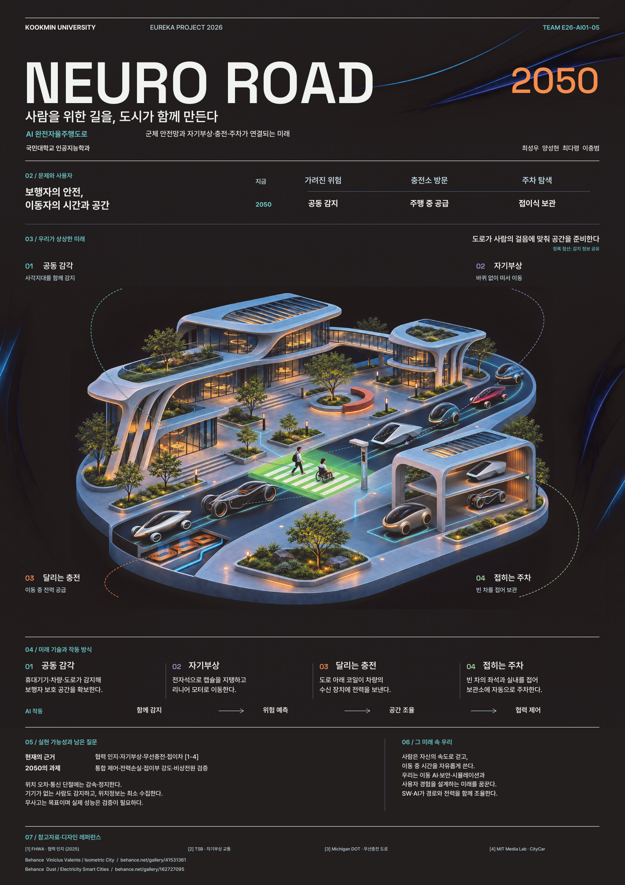

# NEURO ROAD 2050 · 포스터

[팀 홈](../README.md) · [미래 기획](../week07.md) · [출처와 제작 기록](../docs/references.md)

**사람을 위한 길을, 도시가 함께 만든다.**

함께 보는 도로, 바퀴 없는 이동, 달리며 충전, 접히는 주차, 살아 움직이는 도로를 한 장에 담았습니다. **최신 수정본은 Draft07 · 2026.11.05**입니다.

<a class="presentation-button" href="https://kookmin-sw.github.io/E26-AI01-05/poster/present.html"><strong>⛶ 포스터 발표 화면 열기</strong></a>

발표자 컴퓨터에서 위 링크를 열고 **전체화면** 버튼을 누릅니다. <strong>← →</strong>로 제목부터 검증 질문까지 차례로 확대하고, **0**으로 전체 보기, **Esc**로 전체화면을 종료합니다. 상단의 영역 버튼이나 하단의 확대·축소 버튼도 사용할 수 있습니다.

세로 포스터 전체를 볼 때는 좌우에 여백이 생깁니다. 글자를 크게 보여주려면 발표 순서에 따라 영역을 확대해 주세요.

## 파일 보기

| 파일 | 용도 |
| --- | --- |
| [발표 화면](https://kookmin-sw.github.io/E26-AI01-05/poster/present.html) | 전체화면·영역별 확대·키보드 이동 지원 |
| [A0 PDF](NEURO_ROAD_2050_A0.pdf) | 발표·출력용 포스터 1페이지 |
| [편집용 SVG](NEURO_ROAD_2050_Editable.svg) | 글자·배치·심볼·연결선을 수정하는 원본 |
| [편집 패키지 ZIP](NEURO_ROAD_2050_Editable_Package.zip) | SVG, 이미지, 폰트와 라이선스, 제작 기록, 생성 프롬프트 |
| [미리보기 PNG](../assets/neuro-road-2050/poster-preview.png) | 화면 확인용 이미지 |
| [미래 장면 PNG](../assets/neuro-road-2050/city.png) | 웹에서 보는 중앙 장면. 인쇄용 고해상도 이미지는 편집 패키지에 포함 |

## 이번 수정에서 달라진 점

- **5번 기능:** 도로 모듈이 실제로 펼쳐지거나 접혀 폭을 조절하는 모습으로 중앙 그림·심볼·설명을 통일했습니다.
- **배경:** 옅은 하늘색·보라색 그라데이션으로 깊이를 더하고 본문 대비를 유지했습니다.
- **함께 보는 도로:** 차량·보행자 기기·도로 센서 사이의 무선 네트워크를 선과 신호 심볼로 표현했습니다.
- **문제와 사용자:** 국내 자료의 <strong>920명·73%·86.9%</strong>와 출처를 표기했습니다.
- **검증 질문:** 통신 오류, 전력, 도로의 하중과 반복 변형, 개인정보와 책임을 담았습니다.
- **팀원:** **양성현 · 최다령 · 이충범**만 표기하며 개인별 역할은 쓰지 않았습니다.

## 출력 규격

| 항목 | 확인 결과 |
| --- | --- |
| 크기·페이지 | **A0 세로 841 × 1,189mm · 1페이지** |
| 색상 | 이미지·벡터·배경 그라데이션 **CMYK**, 출력 프로파일 포함 |
| 중앙 그림 | 6,688 × 3,764px, 실제 배치 기준 약 **216 DPI** |
| 상단 그림 | 1,855 × 848px, 실제 배치 기준 약 **152 DPI** |
| 글자·심볼 | 벡터, 사용 폰트 포함 |
| 재단선·도련 | 없음 |

중앙 그림은 Open AI 이미지 생성 결과를 **Real-ESRGAN으로 4배 보강**했습니다. 추가된 세부 표현은 AI가 재구성한 결과입니다. CMYK는 SWOP 프로파일을 사용하며, 실제 크기 100%로 출력합니다.

## 포스터를 읽는 순서

1. **제목 및 요약:** 프로젝트명, 핵심 메시지, 2050년의 이동.
2. **문제와 사용자:** 보행 안전, 충전 불확실성, 주차로 인한 시간 낭비.
3. **미래 장면:** 1번부터 5번까지 기능별 장면과 무선 연결망.
4. **기술 방식:** 공동 감각·자기부상·무선충전·접이식 차량·접이식 도로의 원리.
5. **검증 질문:** 기술적 안전성과 사회·윤리적 과제.
6. **하단:** 미래 속 우리, 팀원, 참고자료와 AI·디자인 도구.

## 편집 원본 안내

ZIP을 풀고 안에 있는 Draft07 SVG를 편집 도구에서 엽니다. 한글은 **Pretendard**, 영문 제목과 숫자는 **Space Grotesk**를 사용했습니다. 글자 모양과 줄바꿈을 유지하려면 포함된 폰트를 설치해 주세요.

- `source/assets/fonts/`: 사용 폰트와 SIL Open Font License.
- `source/assets/symbols/`: 다섯 기능의 벡터 심볼.
- `source/assets/future-scene.png`: 인쇄용 고해상도 중앙 이미지.
- `source/image-prompt-expanding-road.txt`: 펼쳐지는 도로 이미지 수정 프롬프트.
- `source/upscale-notes.txt`: Real-ESRGAN 모델·설정·해상도 보강 기록.
- `source/production-notes.txt`: 제작·출력 기록.
- `source/evidence-notes.md`: 통계·설문의 출처와 해석.
- `source/build_poster.py`: 같은 배치를 PDF·SVG로 생성하는 원본.

SVG의 건물·차량은 래스터 이미지 안에 있고, 글자·무선 연결선·기능 심볼은 별도 벡터 요소입니다. 화면용 SVG와 출력용 CMYK PDF는 색감이 약간 다를 수 있습니다.

## 참고자료와 활용 도구

**AI 활용: Open AI 이미지 생성 / Real-ESRGAN 해상도 보강** 
**포스터 레퍼런스 참조: [Behance](https://www.behance.net/) · 디자인 도구: [Canva](https://www.canva.com/)**

[통계·설문·기술 출처와 디자인 참고 목록 →](../docs/references.md)

---

[← 팀 홈](../README.md) · [미래 기획 →](../week07.md)
