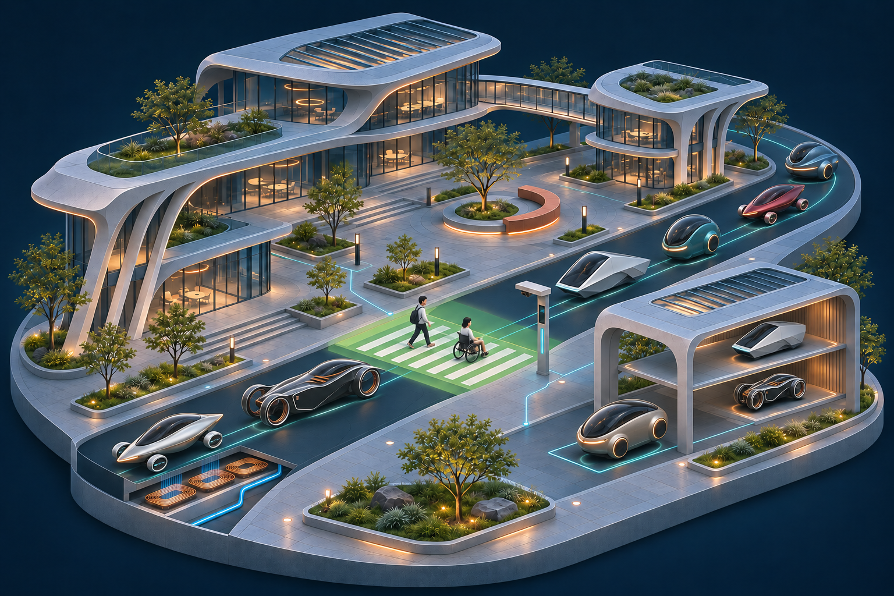

# 7주차 팀 미션: 우리가 상상한 미래

[← 팀 홈](README.md) · [이전: 대학생활 문제 정의](week05.md) · [A0 포스터](poster/README.md) · [미래 속 우리와 발표](presentation.md)

## NEURO ROAD 2050

> **사람을 위한 길을, 도시가 함께 만든다.** 
> 군체 안전망과 자기부상·충전·주차가 연결되는 AI 완전자율주행도로

국민대학교 인공지능학과 · Team E26-AI01-05 
최성우 · 양성현 · 최다령 · 이충범 
작성 2026.11.02 · 수업 연결: Week 03 「우리가 그려보는 미래 I」

[Re:Stage](week05.md)는 대학생활의 불편을 다룬 별도의 문제 정의 활동이다. 기존 미래 서비스 구상은 [Re:Stage 2045 활동 기록](docs/activities/restage-2045.md)에 보존하고, 최종 미래 프로젝트는 NEURO ROAD 2050으로 발전시킨다.

---

## 미션 1. 미래 장면과 문제 선택

### 왜 도로 전체를 연결하는가

우리의 출발점은 **한 차량의 시야에 들어오지 않은 위험을 다른 차량이나 도로 시설이 먼저 알 수 있다면 어떨까**라는 질문이다. 여기에 충전을 위해 별도로 이동하는 시간과 주차 공간을 찾는 부담을 함께 놓고, 이동의 전 과정을 지원하는 미래 도로를 상상했다.

주요 사용자는 대학가를 걷는 학생과 주민, 휠체어 이용자, 캡슐을 타고 이동하는 사람이다. 특정 기기를 가진 사람만 보호받지 않도록, 휴대폰이 없는 보행자도 도로와 차량의 센서로 감지하는 설계를 포함한다.

> **도로가 주변의 움직임을 함께 파악하고, 사람이 지나갈 공간과 차량의 이동·전력·주차를 조율한다면?**

여기서 **군체 안전망**은 관련된 차량과 도로 시설이 정보를 공유하고 행동을 조율하는 구상이다. 해당 도로 구역의 위험과 관련된 참여자에게 필요한 정보를 전달하도록 설계한다. 전국의 모든 차량에 개인의 위치를 계속 전달할 필요는 없다.

### 선택한 미래 장면: 2050년 대학가에서의 이동

다음은 **가상의 사용자 시나리오**다. 실제 이용자 인터뷰나 실험 결과가 아니다.

| 단계 | 미래 장면 | 기대하는 사용자 변화 |
| --- | --- | --- |
| **캡슐 탑승** | 학생이 승차 구역에서 목적지를 선택한다. 탑승 인원과 이동 목적에 맞는 캡슐이 전용 도로로 출발한다. | 이동 중 시간을 독서·휴식 등에 활용한다. |
| **이동과 전력 공급** | 캡슐은 전용 유도로 위를 자기부상으로 이동한다. 전력 공급 구간에서는 도로 코일과 차량 수신 장치를 통해 에너지를 보충한다. | 충분한 공급 조건이 갖춰진 구역에서는 충전소 방문 부담을 줄인다. |
| **사각지대 감지** | 버스 뒤의 보행자를 도로 센서가 감지한다. 휴대기기가 제공하는 정보가 있으면 함께 참고하고, 감지 시각과 위치 오차도 고려한다. | 직접 보이지 않는 사람의 존재를 주변 차량도 고려할 수 있다. |
| **횡단 공간 확보** | AI가 보행자의 가능한 이동 범위와 차량 경로를 비교한다. 관련 차량들이 미리 감속·정지해 횡단 공간을 확보하고, 사람이 건너는 동안 그 공간을 유지한다. | 보행자가 자신의 속도로 이동할 수 있도록 돕는다. |
| **하차와 보관** | 캡슐이 정지한 승하차 구역에서 사람이 내린다. 사람·동물·짐이 남아 있지 않은지 확인한 뒤, 접이 구조를 갖춘 빈 캡슐이 정지 상태에서 좌석과 확장 공간을 접고 보관소로 이동한다. | 이용자는 주차 공간을 직접 찾아다니지 않는다. |

### 현재의 불편과 우리가 기대하는 변화

아래의 미래 항목은 **설계 목표**다. 개선 정도를 측정한 수치는 아직 없다.

| As-Is: 출발점으로 삼은 불편 | To-Be: 2050년의 구상 |
| --- | --- |
| 차량이나 건물에 가려진 보행자를 늦게 알아차릴 수 있음 | 차량·도로·휴대기기의 정보를 함께 고려해 위험을 더 일찍 파악 |
| 보행 속도와 예상 경로가 사람마다 다름 | 실제 움직임과 불확실성을 반영해 보호 공간과 유지 시간을 조정 |
| 충전을 위해 별도로 이동하거나 대기하는 부담 | 주행·승하차·보관 중 필요한 에너지를 공급 |
| 주차 위치를 탐색하고 넓은 보관 면적을 확보해야 함 | 자동 보관과 접이 구조로 이용자의 부담과 차량의 주차 면적을 줄이는 방향 검토 |

### 이 미래가 성립하기 위한 환경 가정

- **전용 도로가 설치된 구역**을 대상으로 한다. 일반 아스팔트 어디에서나 캡슐이 떠다니는 설정이 아니다.
- 차량의 외형과 승차 인원은 다양할 수 있지만, 통신 메시지·전력 수신·유도로 접속 방식은 **공통 인터페이스**에 맞춰 설계한다. 허용 하중과 차량 크기 등 운행 조건도 정해야 한다.
- 모든 기존 자동차가 그대로 호환된다고 가정하지 않는다. 지원 조건을 갖춘 차량의 운행과 일반 도로의 접속 방식을 별도로 검토한다.
- 사람의 행동을 정확하게 읽거나 미래를 확정적으로 예측할 수 있다고 가정하지 않는다. 예측이 불확실할수록 안전 여유를 늘리는 방향이다.

## 미션 2. 미래 서비스 캔버스와 시각화

### 캔버스 7칸

| 항목 | NEURO ROAD 2050의 설계 |
| --- | --- |
| **01 사용자** | 대학가의 보행자와 도시 이동자. 학생·주민·휠체어 이용자·휴대기기를 사용하지 않는 사람을 포함 |
| **02 상황** | 사각지대가 있는 도로를 건너거나, 캡슐로 목적지까지 이동한 뒤 충전·주차를 처리해야 할 때 |
| **03 현재의 불편** | 한 차량의 시야로 확인하기 어려운 위험, 서로 다른 보행 속도, 충전 방문과 주차 탐색에 드는 시간·공간 |
| **04 미래의 변화** | 전용 도로가 차량과 함께 주변을 감지하고 경로를 조율하며, 자기부상 이동·전력 공급·자동 보관을 지원 |
| **05 핵심 경험** | 사람이 횡단하기 전에 주변 차량이 공간을 확보하고, 목적지에서 내린 뒤에는 빈 캡슐이 스스로 보관소로 이동하는 경험 |
| **06 필요한 기술** | 협력 인지, 위치·동작 정보의 결합, 불확실성을 고려한 경로 계획, 통신·인증, 안전 제어, 자기부상과 리니어 모터, 무선전력전송, 접이 구조와 보관 설비 |
| **07 남은 위험** | 위치 오차·통신 지연·센서 오류, 위치정보 노출, 기기 유무에 따른 차이, 전력 손실·정전, 접이부 내구성, 전용 도로의 비용과 유지관리 |

### 포스터에서 보여줄 한 장면

중앙의 대학가 도로에서 **보행자를 위해 차량들이 함께 공간을 확보하는 순간**을 크게 보여준다. 그 주변에 자기부상 차량, 도로 아래 전력 공급 장치, 접힌 차량의 보관소를 배치한다.

그림의 연결선과 보호 영역은 작동 원리를 설명하는 시각적 표현이다. 실제 공중에 빛의 방어막이 생기거나, 그 선 자체가 차량을 멈추게 한다는 뜻은 아니다. 차량 외형의 차이는 다양한 이용 목적을 표현하며, 동일한 도로 시스템에서 운행하려면 공통 인터페이스와 운행 조건을 갖춰야 한다.

[포스터 파일과 편집 원본 보기 →](poster/README.md)

## 04. 핵심 기능 네 가지

### 1. 공동 감각: 사각지대를 함께 감지하기

휴대기기·차량·도로 센서가 제공하는 정보를 결합해 주변의 위치와 움직임을 파악한다. 정보의 시각과 오차를 함께 고려하고, 보행자의 가능한 이동 범위를 보호 영역으로 설정하는 구상이다.

주변 차량은 해당 영역과 자신의 예정 경로가 겹치는지 확인하고 미리 속도와 통과 순서를 조정한다. 휴대기기가 없는 보행자도 센서로 감지하며, 기기 위치만으로 횡단 허용이나 안전 여부를 결정하지 않는다.

### 2. 자기부상: 바퀴 없이 전용 유도로를 따라 이동하기

전자석과 전용 유도로가 캡슐을 지탱하고, 리니어 모터가 이동을 담당한다. 부상 간격과 자세를 계속 제어해야 하며, 차량 크기·하중에 맞는 설계가 필요하다.

자기부상 교통의 원리를 소형 캡슐과 다양한 차체에 적용하는 것은 **우리의 미래 가정**이다. 바퀴가 없어도 관성과 공기저항은 남으므로 제동거리와 안전 간격이 필요하다. 비상전원·제동·안정적인 지지 방법도 함께 검토한다.

### 3. 달리는 충전: 이동 중 필요한 전력을 공급받기

도로 아래 코일이 차량의 수신 장치에 전력을 보내고, 차량은 주행·승하차·보관 과정에서 에너지를 보충한다. AI가 예상 이동 경로와 필요한 전력을 함께 고려해 공급 구간을 조율하는 구상이다.

**에너지는 외부 전력망에서 공급되며, 손실 없이 무한히 달리는 설정은 아니다.** 충전소 방문 부담을 줄이려면 공급량과 사용량의 균형을 확인해야 한다. 전력 공급이 없는 구간과 정전 상황을 위한 배터리도 필요하다. 자기부상·추진 장치와 무선충전 장치는 서로 다른 기능이므로 함께 설치할 때의 간섭과 안전성을 검토해야 한다.

### 4. 접히는 주차: 빈 캡슐의 공간을 줄여 보관하기

승하차 구역에서 정지한 뒤, 탑승자와 동물·짐이 남아 있지 않은지 확인한다. **접이 구조를 갖춘 빈 차량만 정지 상태에서** 좌석과 확장된 실내 공간을 접는다. 배터리나 재료 자체가 줄어드는 것이 아니라 빈 공간을 접어 외형과 주차 면적을 줄이는 설계다.

접힌 차량은 자동 보관 설비에 수납한다. 다시 사용할 때는 차체를 펼치고 잠금 상태를 확인한 뒤 탑승을 허용한다. 접이부 강도·반복 내구성·고장 시 회수 방법을 검증해야 하며, 보관 중에는 받침 구조로 차량을 지지하는 방향을 검토한다.

### 서비스가 작동하는 흐름

**함께 감지 → 위험 예측 → 공간 조율 → 협력 제어**

| 단계 | 입력과 처리 | 설계하는 결과 |
| --- | --- | --- |
| **함께 감지** | 주변 센서·휴대기기 정보의 위치, 움직임, 시각과 오차 확인 | 도로 구역의 공통 상황 정보 |
| **위험 예측** | 보행자의 가능한 이동 범위와 차량의 예정 경로 비교 | 겹칠 가능성이 있는 공간과 필요한 여유 판단 |
| **공간 조율** | 차량의 속도·통과 순서·보호 영역 유지 시간 조정 | 사람이 건너기 전에 필요한 공간 확보 |
| **협력 제어** | 안전 조건을 확인하며 감속·정지·통과 수행 | 상황 변화에 따라 계획을 다시 갱신 |

AI의 예측만으로 안전을 보장하지 않는다. 제어 단계에서 안전 조건을 다시 확인하고, 통신이 끊기거나 정보의 신뢰도가 낮아지면 감속·정지하도록 설계한다. 정확한 전환 조건과 제동 성능은 아직 검증해야 할 과제다.

## 05. 현재의 근거와 미래에 필요한 것

자료 확인일: **2026.11.02**. 다음 사례는 개별 기술의 출발점이다. 네 기술을 통합한 NEURO ROAD 2050이 이미 구현되었거나, 2050년에 실현된다고 보장하는 근거는 아니다.

| 현재의 참고 사례 | 공식 자료에서 확인한 내용 | 우리 구상에서 추가로 필요한 것 |
| --- | --- | --- |
| [FHWA · 협력 인지](https://highways.dot.gov/FHWA-HRT-25-092) | 도로 센서가 감지한 보행자 정보를 차량에 공유하는 연구 | 여러 차량의 행동 조율, 위치·통신 오차를 고려한 보호 영역과 안전 검증 |
| [TSB · 자기부상 교통](https://transportsystemboegl.com/en/vehicle/) | 전자기 부상과 리니어 모터를 사용하는 교통 시스템 | 소형 캡슐 적용, 다양한 하중·차체의 호환, 분기·정차·비상 상황 설계 |
| [Michigan DOT · 무선충전 도로](https://www.michigan.gov/mdot/travel/mobility/initiatives/wireless-charging-roadway) | 도로 코일과 수신 장치를 갖춘 차량 사이에 정차·주행 중 전력을 전달하는 시험 | 공급 전력과 사용량의 균형, 전력 손실·설비 비용·유지관리, 부상 장치와의 통합 |
| [MIT Media Lab · CityCar](https://www-prod.media.mit.edu/projects/citycar/overview/) | 접이 구조로 주차 면적을 줄이는 바퀴 달린 전기차 연구 | 자기부상 캡슐에 맞는 구조, 탑승자 확인, 접이부 강도·내구성과 자동 보관 |

### 2050년을 상상하는 이유

우리는 **차량과 도로가 함께 안전·에너지·공간을 관리하는 생활 환경**을 구상한다. 이를 위해서는 개별 기술의 발전과 함께 공통 규격, 운영 주체, 유지관리 비용과 이용자의 신뢰가 필요하다.

| 현재 검토할 수 있는 것 | 2050년에 기대하는 환경 | 아직 확인하지 못한 조건 |
| --- | --- | --- |
| 하나의 횡단 장면을 도식·시뮬레이션으로 비교 | 여러 차량이 보행자의 보호 공간을 함께 유지 | 감지·통신·제어의 오류가 겹칠 때의 안전성 |
| 부상·충전·접이 기술의 개별 사례 조사 | 같은 도로와 보관소를 쓰는 다양한 소형 캡슐 | 하중·크기·통신·전력·기계 구조의 호환 |
| 가정한 이동 거리에 대한 에너지 예산 검토 | 이동 중 공급으로 충전소 방문 부담 감소 | 실제 전력 손실, 공급 용량, 배터리와 비상전원 크기 |
| 접이 전후의 구조와 보관 동선 설명 | 하차 후 자동 접이·보관·재출고 | 접이부 내구성, 고장 차량의 회수, 공간 절감의 실효성 |

## 06. 검증 질문과 멘토링 준비

아래는 **앞으로 수행할 검증 계획**이다. 실험 결과나 멘토의 실제 답변을 기록한 표가 아니다.

| 영역 | 핵심 질문 | 확인할 방법 또는 항목 |
| --- | --- | --- |
| **보행자 안전** | 버스 뒤의 사람, 느린 보행, 갑작스러운 방향 변화에도 공간을 확보하는가? | 동일한 횡단 장면에서 감지 시점·최소 간격·정지 여부를 비교하고 실패 사례 기록 |
| **통신·센서 오류** | 지연·단절·위치 오차가 생기면 어떻게 행동하는가? | 오류 조건을 바꾼 시뮬레이션에서 감속·정지 전환과 충돌 가능성 확인 |
| **접근성과 개인정보** | 기기가 없는 사람도 보호하며, 이동정보를 과도하게 남기지 않는가? | 기기 없는 시나리오 포함. 필요한 정보·공유 범위·보관 기간과 재식별 위험 검토 |
| **에너지** | 부상·이동·차내 장치의 사용량을 도로 공급으로 보충할 수 있는가? | 전송 손실을 포함한 에너지 예산과 공급 공백·정전 시나리오 비교 |
| **접이와 보관** | 빈 차임을 확인하고, 접었다 펴도 구조가 안전한가? | 탑승자·동물·짐 확인 절차, 잠금 상태, 반복 내구성, 고장 시 회수 동선 점검 |
| **호환성과 운영** | 다양한 차량을 같은 설비에서 운영할 수 있는가? | 허용 하중·차체 크기·접속 규격·유지보수 비용과 운행 책임의 범위 정리 |

사고 감소율, 충전 효율, 주차 면적 절감률은 아직 측정하지 않았으므로 성과 수치로 제시하지 않는다. 실제 도로 운행 실험에 앞서, 이번 발표에서는 개념도와 자료 비교를 통해 설계의 빈틈을 설명한다.

### 멘토에게 가져갈 질문

1. **안전:** 위치·통신 오차가 있을 때 보행자 보호 영역과 감속·정지 조건을 어떤 순서로 정의하면 좋을까?
2. **통합:** 자기부상과 무선충전을 같은 도로에 적용할 때 전력·간섭·비상전원 중 무엇을 먼저 검토해야 할까?
3. **구조와 운영:** 다양한 캡슐의 접이·보관을 위해 공통으로 정해야 할 규격과 최소 검증 항목은 무엇일까?

멘토링 내용을 반영할 때에는 실제 의견과 팀의 해석을 구분하고, **수정할 세 가지와 다음 행동 한 가지**를 기록한다.

## 07. 그 미래 속 우리의 모습

사람은 자신의 속도로 길을 건너고, 이동 중 시간을 자유롭게 쓰며, 목적지에서 내린 뒤 주차를 직접 처리하는 부담을 덜 수 있다. 이 변화가 기기 사용 능력이나 경제적 조건에 따라 달라지지 않도록 운영 방식도 설계해야 한다.

우리는 이런 미래에서 **이동 AI·보안·시뮬레이션·사용자 경험을 설계하는 역할**을 상상한다. AI는 움직임과 위험을 예측하고, SW는 차량의 경로·전력·보관 상태를 연결하며 안전 조건을 확인한다. 사람은 목표와 허용 범위를 정하고 실패 사례를 검토한다.

이는 팀의 미래 역할에 관한 제안이며, 실제 구현 실적이나 확정된 개인별 업무 분담이 아니다. 각자의 관심사와 발표 내용은 [미래 속 우리와 발표](presentation.md)에서 이어서 정리한다.

## 08. 90초 기획 소개 대본 초안

> 저희가 상상한 미래는 NEURO ROAD 2050, AI 완전자율주행도로입니다.
>
> 도로에서 한 차량이 보지 못한 사람을 다른 차량이나 도로 센서가 먼저 알 수 있다면 어떨까요? 저희는 주변의 움직임을 함께 파악하고, 보행자가 건너기 전에 여러 차량이 공간을 확보하는 미래를 구상했습니다.
>
> 2050년의 전용 도로에서는 다양한 자기부상 캡슐이 이동합니다. 도로가 필요한 전력을 공급하고, 목적지에서 사람이 내리면 접이 구조를 가진 빈 캡슐이 정지 상태에서 작아져 보관소로 들어갑니다. 사람은 자신의 속도로 걷고, 충전과 주차에 쓰던 시간을 줄일 수 있습니다.
>
> 작동 흐름은 함께 감지하고, 위험을 예측하고, 공간을 조율한 뒤 함께 제어하는 것입니다. 휴대폰이 없는 사람도 감지하고, 통신 오류에는 감속·정지하도록 설계합니다.
>
> 개별 기술의 사례는 이미 있지만, 이를 통합한 도로의 안전성은 검증해야 합니다. 무사고는 보장된 결과가 아니라 목표입니다. 저희는 위치 오차, 전력 손실과 접이부 강도 같은 남은 질문까지 포스터에 담았습니다.

이 대본은 수업 미션의 짧은 기획 소개용이다. 최종 발표는 [A0 포스터](poster/README.md)를 중심으로 진행하며, 발표 흐름은 [별도 문서](presentation.md)에 정리한다.

## 09. 제작 기록과 다음 행동

| 구분 | 기록 |
| --- | --- |
| **사용자가 제시한 방향** | 완전자율주행도로, 휴대기기·차량·도로의 군체 연결망, 자기부상, 주행 중 충전, 빈 차량의 접이식 자동 주차 |
| **AI의 지원** | 아이디어 정리, 공식 자료 조사, 미래 시나리오·문구 구성, 도시 콘셉트 이미지 제작 |
| **현재 결과물** | 미래 기획 문서와 A0 포스터 초안. 실제 차량이나 도로 시스템을 구현한 결과는 아님 |
| **검토 기준** | 현재의 근거와 미래 가정 구분, 무사고 보장·허구의 성과 수치 배제, 기기 없는 보행자와 오류 상황 포함 |
| **다음 행동** | 팀이 대표 횡단 장면과 전용 도로의 범위를 검토하고, 멘토에게 안전·전력·접이 구조의 우선 검증 항목을 질문 |

포스터의 필수 구성에 맞춰 **문제와 사용자, 2050년의 모습, 작동 방식, 실현 가능성과 문제, 미래 속 우리의 역할, 출처**를 함께 제시한다. 수업의 캔버스 7칸과 90초 소개 형식을 유지했으며, 검증 질문은 멘토링에서 구체화한다.

---

[← 대학생활 문제 정의](week05.md) · [팀 홈](README.md) · [A0 포스터](poster/README.md) · [미래 속 우리와 발표 →](presentation.md)
